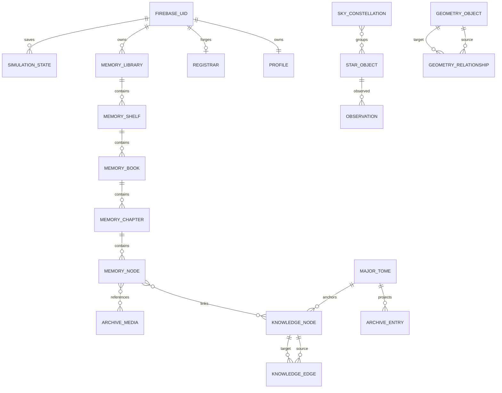

# Database schema draft

No collections are created by this scaffold. Existing Firestore models and proposed Explorer records are separate. No SQL backend is introduced.

## Existing records

| Path | Purpose / relationships | Checked-in rule boundary |
|---|---|---|
| users/{uid} | Account root | Owner read/write |
| users/{uid}/profile/main | displayName, email, avatarUrl, school, Arts, Vis, progression | Owner-only via catch-all |
| users/{uid}/registrar/main | Ledger Seed, geoVector, Cosmological ID, tier, certificate, certifiedPlanes | Owner create/update; critical authority issue in security report |
| users/{uid}/tomes/{id}, quests/{id} | Learning progress and quest completion | Owner read/write |
| users/{uid}/minorTomes/{sealId} | Private ECDSA JWK and seal parameters | Owner read/write; never project private fields |
| users/{uid}/transactions/{id} | Vis transaction history | Owner read/create; immutable updates/deletes |
| users/{uid}/inventory/{id} | Purchased items | Owner write currently includes delete |
| tomes/{id}, artifacts/{id} | Mutable authored educational content | Signed-in read, role/owner write branches |
| majorTomes/{id} | Immutable inscribed Major Tome canon | Signed-in read; stored-tier Archon create |
| seals/{sealId} | Public-key registry, ownerUid, lifecycle | Signed-in read; owner create/lifecycle updates |
| unlockRequests/{id} | Student, tome, seal, kind, signed request, status | Student/Instructor/Archon reads; student create; privileged resolve |
| tomeUnlocks/{id} | Learner + Instructor signatures, status/kind, tome reference | Signed-in read; privileged create/revoke |
| chronicles/{id} | Client-submitted audit events | Signed-in create; client reads denied |
| constellations/{uid} | Public Genesis position, identity and owned-content context | Signed-in read; owner write |
| guilds/{id}, guilds/{id}/chronicle/{entry} | Member groups and events | Signed-in reads; member writes |
| biochains, biochainTransfers, biomeshCodices, biochainRatings | Chain provenance, free transfers, immutable codices, ratings | Collection-specific ownership/lifecycle rules |

Root paths are not recursive grants by themselves. Read exact rules before querying. Account roots cannot be enumerated merely because the user can read their own record. No Storage rules/index manifest was found; deployed policies remain unknown.

## Template collections mapped to actual Academy concepts

| Template | Proposed storage / source |
|---|---|
| users | Existing Firebase UID / users document; safe identity projection only |
| profiles | Existing users/{uid}/profile/main; no parallel profile collection |
| roles | Future server-owned verified authority projection; legacy registrar is not trusted |
| permissions | Versioned reviewed policy, not owner-editable documents |
| memory_nodes / memory_books / memory_shelves | memoryNodes / memoryBooks / memoryShelves |
| archive_entries / archive_media | archiveEntries / archiveMedia |
| knowledge_nodes / knowledge_edges | knowledgeNodes / knowledgeEdges |
| star_objects / constellations / observations | starObjects / skyConstellations / observations |
| geometry_objects / geometry_relationships | geometryObjects / geometryRelationships |
| simulation_states | simulationStates |

For future sandbox evaluation, every new collection is under `celestialHypersim/sandbox/{collection}/{id}`. The namespace document has subcollections; there is no automatic implicit permission inheritance. Additional memoryLibraries and memoryChapters complete the requested hierarchy. Production namespace/project selection is undecided and requires review. The example rules deny all access.

## New entity contracts

All 15 proposed record types have id, entityType, schemaVersion=1, ownerUid, private/academy visibility, dept plane, createdAt and updatedAt. Times use RFC 3339 strings at the JSON boundary; a future Firestore adapter explicitly maps server Timestamps. Authority is never established by these fields.

- **memoryLibraries**: title.
- **memoryShelves**: libraryId, title.
- **memoryBooks**: shelfId, title, canonIds.
- **memoryChapters**: bookId, title, position.
- **memoryNodes**: chapterId, title, notes, mediaIds, knowledgeNodeIds.
- **archiveEntries**: title, sourceType, sourceId, mediaIds.
- **archiveMedia**: title, storagePath, mimeType, sizeBytes.
- **knowledgeNodes**: label, kind, canonId.
- **knowledgeEdges**: sourceId, targetId, kind.
- **starObjects**: name, catalogId, rightAscensionDeg, declinationDeg, epoch, frame, provenance.
- **skyConstellations**: name, starIds, provenance.
- **observations**: starId, observedAt, notes.
- **geometryObjects**: name, kind, parameters, units.
- **geometryRelationships**: sourceId, targetId, kind.
- **simulationStates**: moduleId, sceneId, revision, seed, position, linkedNodeIds.

Full Draft 2020-12 schemas live in `schemas/entities.schema.json`; `data/examples.json` contains one synthetic example for each proposed type and each of the four identity/policy projections. Tests validate every example and reject unknown sensitive fields. Examples are not migrations or production seeds.

## Relationships

Firestore does not enforce foreign keys. A trusted service/rules layer must verify referenced existence, owner/visibility compatibility, acyclic memory containment, permitted plane, immutable identity fields, and bounded fan-out. JSON Schema alone cannot do this. A graph edge may not expose a private target through an academy-shared source.

## Query/index strategy

Existing helpers use single-field studentUid queries on tomeUnlocks and unlockRequests. Admin Console filters tomes by plane/status and orders createdAt; tome-authoring filters creatorUid with createdAt, and plane with priority/createdAt. Those compound queries may need deployed composite indexes; none are proven present here.

Proposed indexes are listed in `firebase/firestore.indexes.draft.json`: owner + parent + updatedAt for memory, owner + source for graph, owner + star/time for observations, and owner + scene/update for saves. They are design artifacts, not deployed resources. Queries must include access-compatible predicates because Firestore rules are not filters. Add pagination/cursors and bounded limits before live lists. Do not index private note text or use Firestore as an unbounded semantic/full-text engine.

## Lifecycle and media

Default new user data to private. Archive catalog entries and vetted sky/geometry reference data may be academy-shared only through explicit publication. Parent deletion is not an automatic cascade: plan archive/reparent/export and reference cleanup atomically where feasible, with a background repair policy. simulationStates use expected revision for conflict checks. Media paths use an isolated prefix and checked metadata; a declared MIME type is not file-content verification. Storage policy, malware screening, size enforcement, retention and download authorization must be designed before uploads.
