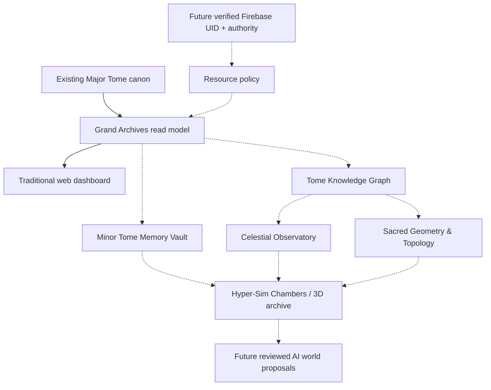

# Systems overview

The Grand Archives module is the Explorer shell, not a replacement for `Library/Grand_Archives.html`. All presentations share stable canonical references and typed read models rather than maintaining separate curricula per renderer.

Solid arrows represent current file projection and dashboard use; dotted arrows are planned. Module boundaries, ownership, data contracts, next work and acceptance criteria are in `modules/README.md`. Each engine directory contains a scoped continuation contract. No subsystem may interpret a future scene, AI output, or personal note as authority to issue certificates or award progression.
