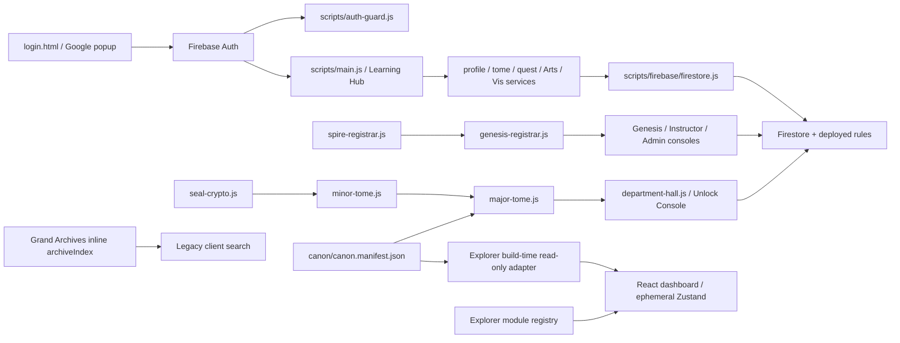

# Dependency map

The only live cross-subtree dependency in the new scaffold is reading the checked-in canon file at build time. All API/Firebase/identity integration remains disconnected. Root Python and Lean projects have separate toolchains; the Explorer does not execute them.

| Package | Responsibility | Initial use |
|---|---|---|
| Next.js + React + TypeScript | Static App Router build, typed views | Active |
| Zustand | Search, selected module, department filter | Active; no persistence/auth |
| Firebase npm SDK | Future reviewed Auth/Firestore adapter | Installed, not initialized |
| Three.js + React Three Fiber | Future scene/rendering adapter | Installed, not imported into initial bundle |
| Ajv + ajv-formats | Draft 2020-12 example validation | Tests only |
| tsx + Node test runner | TypeScript domain/contract tests | Tests only |

Exact package versions and integrity hashes are recorded in package-lock.json. Use npm ci; do not modify the Academy's parent package state to install this subsystem. No CDN scripts or remote fonts are needed by the new dashboard. `next.config.mjs` limits build workers to two and uses webpack for a predictable nested-project build.
