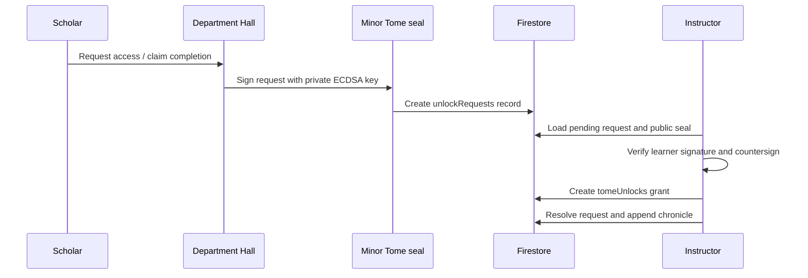

# Existing Owl Academy architecture

Scope: static application, shared browser services, curriculum, Mage Tower control panels, storage, authorization, representative geometry/research modules, and CI. Findings are anchored to source paths relative to the repository root. Lean proofs and experimental Python modules are independent research tools, not website backends.

## Runtime and authentication

`.github/workflows/static.yml` uploads the repository as a Pages artifact. HTML files are routes; there is no application server, Next.js router, centralized route manifest, custom API middleware, or SQL database in the existing site. Most large pages contain inline logic and CDN libraries. Shared browser ES modules live in `scripts/`.

`login.html` initializes Firebase and Google popup sign-in directly. `scripts/firebase/config.js` exports the shared Auth, Firestore, and Storage clients; `scripts/firebase/auth.js` wraps Google sign-in, sign-out, and auth-state observation. There is no custom JWT signer/verifier or application session-cookie implementation in the inspected code. Firebase SDK owns ID tokens, refresh, and auth persistence; no explicit persistence override was found. Browser Firebase Auth defaults must be verified in the intended browser, particularly across origins. Cosmological IDs and seal signatures are separate from Firebase UID authentication.

`scripts/auth-guard.js` hides the document, waits for `onAuthStateChanged`, and reveals the page or redirects to `login.html?redirect=...`. It also supplies `globalLogout`. `scripts/main.js` uses its own hub auth state machine and live profile subscription. These are browser guards, not HTTP authorization. Not every page uses the shared guard: `Library/Grand_Archives.html` contains no shared Firebase guard in the inspected revision. Static HTML remains downloadable regardless of UI locks.

## Identity, roles, and progression

`scripts/spire-registrar.js` derives a Cosmological ID and geometric vector from a Ledger Seed and UID, writes `users/{uid}/registrar/main`, and offers local/export backup. `scripts/genesis-registrar.js` defines Acolyte → Instructor → Archon, hardcoded root UIDs, HMAC certificates, `resolveTier`, plane checks, and priority stamps. Certified planes such as `dept-IV` restrict authoring in browser helpers. Rules check the stored tier rather than certificate validity or certified planes. See the security report before reusing this authority model.

`users/{uid}/profile/main` stores display data, school, Arts XP, Vis, completion maps, and quest state. Schools include Geometer, Arithmetician, Sacred Scientist, Biochain Architect, and Hyper-Sim Topologist. Arts cover mathematics, geometry, sacred sciences, biochain, and computation. An XP rank called “Archon” is not the `ARCHON` authority tier: never derive permissions from rank, XP, school, or Vis.

## Classes and lessons: three overlapping catalogs

1. `Library/Grand_Archives.html` has inline `archiveIndex` records (title, department, type, category, status, URL, keywords). Search is client-side string matching. Locked/stub/reference presentation is a navigation affordance, not content protection. The old Developer Reference Manual's `owl_academy_tomes` inventory description is not implemented by this page in the inspected revision.
2. `tomes` and `artifacts` are mutable author-created records, handled by `scripts/tome-authoring.js` and the Instructor/Admin consoles. Priority is experimental, validated, or canonical according to creator tier. Department planes differ from the canon's Roman department codes.
3. `canon/canon.manifest.json` defines 145 stable Major Tome seats: 9 in each Department I–IX and 64 in X. It includes canonId, globalIndex, artifact, clusterIndex, title, status, requiredTier, prerequisites, contentPath, lattice, manifold, and seed override. `scripts/major-tome.js` lets an Archon inscribe immutable `majorTomes` records. The file manifest and inscribed Firestore state are not automatically synchronized.

`scripts/ui/department-hall.js` renders thin department HTML shells from `majorTomes`. It loads the learner's Minor Tomes, unlock requests, and grants; generates sigils; and offers request-access/claim-completion actions. Its chips rely on grant status, while `isUnlockedFor` and `isCompletedBy` in `major-tome.js` perform signature verification. The lesson hyperlink itself is rendered when contentPath exists, independently of the unlock chip. Public Pages files cannot be made confidential by this flow.

## Learning-record flow

These writes are sequential, not an atomic approval transaction. `scripts/minor-tome.js` stores private signing keys in owner-only Minor Tome documents and public keys in `seals`. `scripts/seal-crypto.js` implements P-256 signatures and payload formats. Signed content verification checks seal lifecycle; unlock verification currently has different lifecycle behavior (security report).

`scripts/services/tome.service.js` stores started/reading/mastered records at `users/{uid}/tomes/{tomeId}` and awards XP/Vis when status advances. `quest.service.js` defines four quests, records completion under the user, and awards rewards. `arts.service.js` and `vis.service.js` update profile balances and transaction records. These helpers run in the browser, not a trusted rewards service. The `getAllTomes` profile map and per-tome documents are separate surfaces; a future adapter must select an authoritative record rather than silently merge them.

## Control panels

| Entry point | Responsibilities | Main dependencies / records |
|---|---|---|
| `Learning-Hub.html` | Sanctum/Athenaeum/Atelier navigation, profile and quests | `main.js`, `ui/*`, `services/*`, user profile |
| `Library/Grand_Archives.html` | Department navigation and static research search | Inline archiveIndex; CDN styling |
| `mage_tower/Codex.html` | Profile, rank, Registrar, certificates, XP/Vis synchronization | Registrar/profile/tomes |
| `mage_tower/Registrar.html` | Forge identity | `spire-registrar.js` |
| `mage_tower/Genesis_Forge.html` | Root bootstrap and certificate issuance | `genesis-registrar.js` |
| `mage_tower/Instructor_Console.html` | Author tomes/artifacts on certified planes | `tome-authoring.js` |
| `mage_tower/Admin_Console.html` | Static department catalog, tome registry, artifact management, instructor chain view | Firestore queries, Registrar/tier helpers; Instructor or Archon browser gate |
| `mage_tower/Unlock_Console.html` | Canon inscription and request approvals | `major-tome.js`, Minor Tome seals |
| `mage_tower/Seal_Forge.html` | Mint, recall, archive Minor Tomes | `minor-tome.js` |
| `mage_tower/Constellation_Map.html` | Public Genesis-position map and owned-content context | `constellations/{uid}`, tomes/artifacts; not an astronomical catalog |
| `mage_tower/Biomesh_Console.html` | Biochain growth, pairing, transfers, ratings | `biomesh.js`; biochain collections |

No separate staff role, student roster, enrollment/cohort table, school administrator role, or conventional class scheduling subsystem was found. “Student” maps to an Acolyte's learning activities; Instructors/Archons can also learn.

## Data and frontend reuse

Firestore is the observed database. Firebase Storage is initialized, but no checked-in Storage rules, upload-policy deployment, or index manifest was found. No PostgreSQL, MongoDB, or MySQL application connection was found. `scripts/firebase/firestore.js` supplies document CRUD, queries, timestamps, and subscriptions. It does not perform application schema validation or authorization itself.

Existing UI modules use imperative DOM rendering and inline templates, not React contexts/hooks/stores. Styles use a dark void palette, gold/purple/cyan accents, serif headings, and monospace data. Reuse domain vocabulary, stable canon IDs, curriculum metadata, colors, and a future reviewed Auth adapter. Avoid importing browser CDN modules directly into a Node/Next build. See DependencyMap for exact boundaries and DatabaseSchema for collections/indexes.

The new scaffold uses Next.js App Router with static export, React, TypeScript, and ephemeral Zustand state. `app/page.tsx` reads the public manifest at build time, `ui/ExplorerDashboard.tsx` renders it, and `modules/registry.ts` describes extension points. No API routes are enabled. All other engines are architecture contracts for future implementation.
